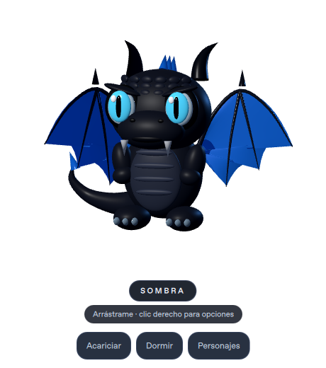

# Mascota · Desktop AI Pet 🐉

Un pequeño compañero **3D real** para el escritorio: **Sombra**, un dragón bebé de cuerpo negro, alas azules y dos pequeños colmillos. Esta primera versión funciona sin cuentas, claves de API ni conexión a Internet después de instalar sus dependencias.

El personaje del prototipo está construido con geometría 3D y articulaciones animadas. La versión **0.2** añade alas suaves, cuernos y cola curvos, escamas en la frente, parpadeo y ojos que siguen el cursor. Las imágenes de `assets/` son referencias de diseño: el modelo actual es más sencillo y todavía no reproduce sus escamas detalladas.



[Ver la llamarada azul del modelo 3D](docs/prototipo-llamarada.png).

## Probar en Windows 11

1. Instala **Python 3.12 de 64 bits** desde [python.org](https://www.python.org/downloads/windows/), incluyendo el lanzador `py`.
2. Descarga este repositorio desde **Code → Download ZIP** y **extrae la carpeta completa**.
3. Haz doble clic en **`iniciar.cmd`**. La primera vez descargará las dependencias; las siguientes arranca directamente.

La mascota aparece sobre el escritorio, con fondo transparente y sin bordes. Para cerrarla, usa **clic derecho → Salir** o **Esc**. No hace falta abrir un navegador para usarla.

### Controles

| Acción | Cómo hacerlo |
| --- | --- |
| Acariciar | Clic en la mascota o botón **Acariciar** |
| Moverla | Arrastrar con el botón izquierdo |
| Girar el modelo 3D | Rueda del ratón sobre el personaje |
| Dormir / despertar | Botón **Dormir** / **Despertar** |
| Cambiar de personaje | Botón **Personajes** o clic derecho |
| Volar | Clic derecho → **Volar un ratito** |
| Saltar | Clic derecho → **Dar un salto** |
| Llamarada / magia | Clic derecho → **Lanzar llama azul** / **Hacer magia** |
| Ponerle un nombre | Clic derecho → **Cambiar su nombre** |
| Activar / desactivar paseos | Clic derecho → **Pasear por el escritorio** |
| Recuperar la posición | Clic derecho → **Volver al centro** |

Incluye **Sombra** (dragón negro y azul), **Brote** (dragón verde) y **Nimbo** (espíritu flotante). Puedes cambiar sin reiniciar la aplicación. Cada personaje conserva su propio nombre, de hasta 24 caracteres. Los nombres, la selección y la preferencia de paseos se guardan localmente en la carpeta de configuración de tu usuario. La llamarada es una animación visual, todavía sin sonido.

## Ejecutable portable para Windows

En GitHub, abre **Actions → Crear Mascota para Windows**. Cada cambio del programa lanza una compilación; también puedes elegir **Run workflow**. Si la ejecución termina correctamente, descarga **Mascota-Windows** desde sus artefactos, extrae **todo** el ZIP y abre `Mascota.exe`. Conserva `Mascota.exe` junto a la carpeta `_internal`.

Ese paquete no requiere instalar Python. Es una carpeta portable, aún no un instalador firmado. El flujo comprueba las pruebas, el renderizado y que el ejecutable empaquetado pueda dibujar un fotograma antes de ofrecer el artefacto.

Para generarlo manualmente **en Windows**:

```powershell
py -3.12 -m venv .venv
.venv\Scripts\python -m pip install -r requirements.txt pyinstaller==6.16.0
.venv\Scripts\python tools/build_windows.py
```

## Desarrollo y pruebas

Python 3.12, PySide6 / Qt Quick 3D 6.9.3. Las dependencias de desarrollo están fijadas en `uv.lock`.

```bash
uv sync --frozen
uv run --frozen python -m mascota
uv run --frozen python -m pytest -q
```

Para probar sin una pantalla física en el entorno cloud Debian:

```bash
bash tools/setup-cloud.sh
.venv/bin/python tools/headless.py .venv/bin/python -m pytest -q
.venv/bin/python tools/headless.py .venv/bin/python -m mascota --smoke-test --capture .local/captura.png
.venv/bin/python tools/headless.py .venv/bin/python -m mascota --pose roaring --capture .local/llamarada.png
```

`tools/headless.py` crea una pantalla Xvfb solo durante el comando, usa Mesa/OpenGL y la cierra al terminar. No expone puertos de red. `setup-headless.sh` descarga Xvfb desde los repositorios Debian verificados y lo extrae en `/workspace/.cache`, sin instalar paquetes en el sistema. El archivo de dependencias y el código no se modifican durante el setup.

Las pruebas de interfaz comprueban renderizado 3D, giro, clics del menú, selección persistente, sueño, caricias, arrastre, salto, llamarada, escritura de nombres, parpadeo, mirada y límites del escritorio. También se validan los límites y las normales de las mallas curvas. En Linux sin pantalla se omiten las seis pruebas de interfaz; usa el comando con `headless.py` para ejecutarlas.

## Alcance de esta versión

- Animación procedural de respiración, parpadeo, mirada, patas, cabeza, cola y alas; sueño, caricias, saltos, llamarada y vuelo corto.
- Ventana transparente sobre el escritorio y paseos dentro del área útil del monitor actual.
- Tres personajes y preferencias locales, sin conexiones a servicios externos.
- Preparación de paquete Windows con PyInstaller.

La integración con el escritorio y las transparencias de Windows deben comprobarse también en un equipo Windows 11 real. La pantalla virtual de Linux no valida ese comportamiento específico. Todavía no incluye IA, voz, recordatorios, un modelo artístico detallado ni detección para sentarse sobre otras ventanas.
